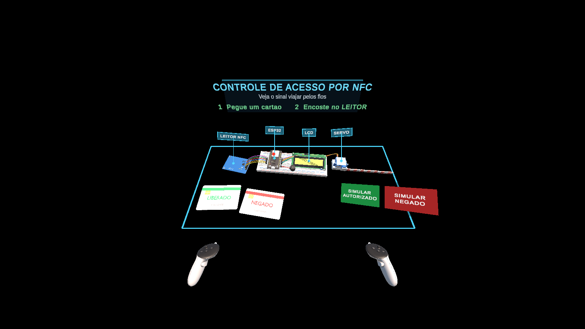
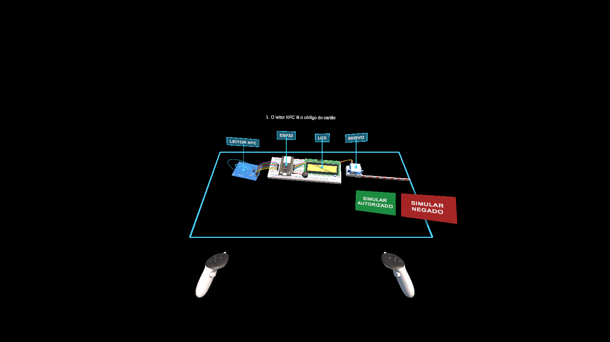
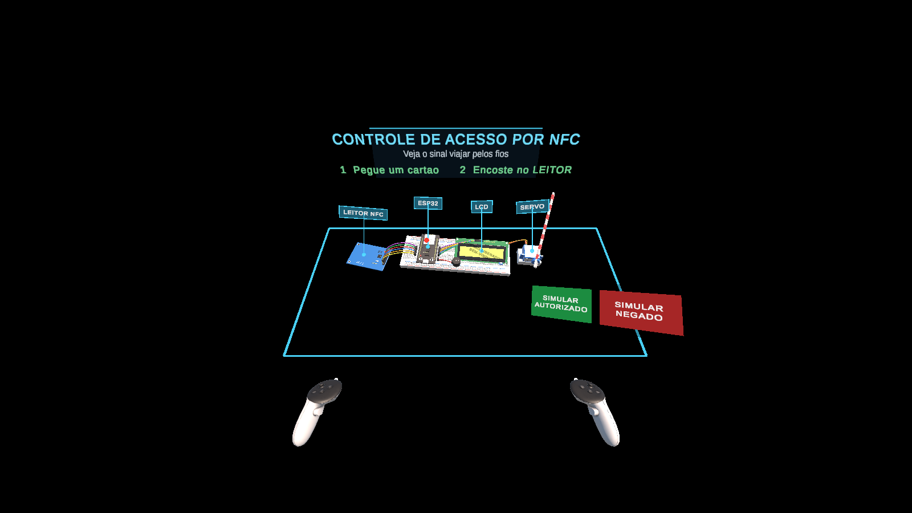
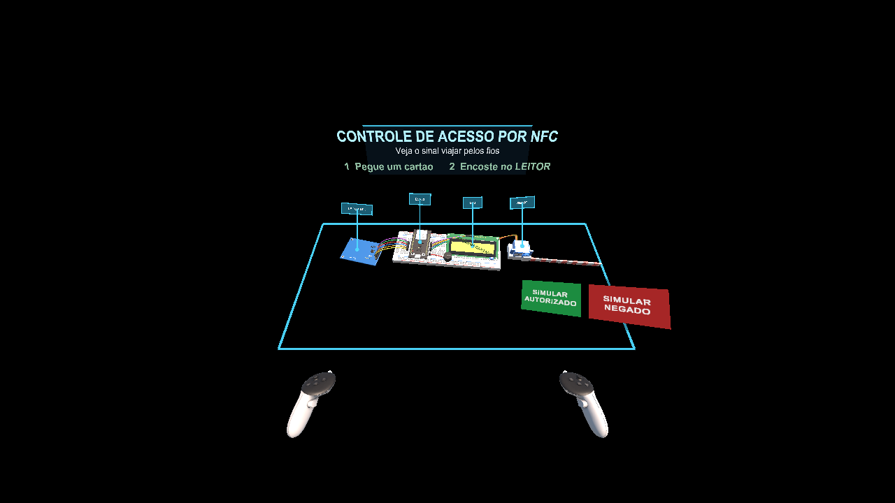

# ControleAcessoMR

App de **realidade mista** para Meta Quest 3/3S que mostra, "ao vivo", como funciona um kit
de controle de acesso por cartão NFC montado para uma feira escolar.

O visitante coloca o óculos e vê, sobre a mesa, um **kit virtual em 3D** (cópia do kit
real, 2x maior) ao lado do kit de verdade, no estilo da foto de referência: etiquetas
"LEITOR NFC / ESP32 / LCD / SERVO", luz percorrendo o caminho do sinal, o LCD virtual
escrevendo, a cancela subindo e um painel **ACESSO AUTORIZADO** (verde, cadeado aberto)
ou **ACESSO NEGADO** (vermelho, cadeado fechado).

A animação dispara de 3 jeitos:
1. **Cartão virtual** (LIBERADO ou NEGADO) pego com a mão/controle e encostado no leitor virtual.
2. **Cartão real** passado no kit real (o ESP32 avisa o óculos pelo Wi-Fi).
3. **Simulação**: botões "SIMULAR AUTORIZADO/NEGADO" ou botão Menu (plano B).

Os 2 cartões existem nos dois mundos: cartões tipo cartão de crédito escritos LIBERADO / NEGADO.

> **Feira:** última semana de novembro de 2026.
> Dono do projeto: iniciante em Unity/Blender. Explicar tudo em português simples.
>
> **Regras para o agente:** usar automaticamente todas as skills úteis (Meta `hz-*`, Unity, Blender,
> ponytail, graphify, design...) sem perguntar; sempre que possível mostrar o resultado com foto
> (captura do Unity/Blender); backup git antes de mexer; plano antes de mudanças grandes.
> **Não gerar APK até o dono pedir**; quando gerar, publicar como Release no GitHub.

---

> **Guia de teste passo a passo e tabela de botões:** [GUIA_DE_TESTE.md](GUIA_DE_TESTE.md)
> **Histórico, decisões e como continuar num chat novo:** [HISTORICO.md](HISTORICO.md)
> **APK:** quando gerado, fica nas **Releases** deste repositório no GitHub.

## O kit físico

| Peça | Função |
|---|---|
| RC522 (leitor NFC, 13,56 MHz) | Lê o cartão NFC e envia o código |
| ESP32 | Recebe o código e decide se autoriza |
| LCD 16x2 | Mostra o resultado |
| Servo (cancela) | Abre quando o acesso é autorizado |
| Buzzer | Bipes de abrir, fechar e negado |

**Regra importante:** o kit funciona **sozinho**, sem o óculos. O óculos só *assiste*
ao que acontece; nunca é obrigatório e nunca comanda o kit.

---

## Pastas

| Pasta | O que tem |
|---|---|
| `Assets/ControleAcessoMR/ControleAcessoMR.cs` | Comando do app: posiciona o kit (QR/manual), etiquetas, liga cartão virtual + ESP32 + simulação |
| `Assets/ControleAcessoMR/KitVirtual.cs` | Kit 3D: detecta cartão no leitor, LCD, cancela, buzzer, devolve cartões |
| `Assets/ControleAcessoMR/FluxoAcesso.cs` | Animação do sinal (pulso com rastro) + painel com cadeado; avisa o kit a cada etapa |
| `Assets/ControleAcessoMR/EspCliente.cs` | Consulta `/evento` do ESP32 |
| `Assets/ControleAcessoMR/KitVirtual.prefab` | Kit 3D pronto (gerado pelo menu ControleAcessoMR > Montar kit virtual) |
| `Assets/Editor/` | Scripts de montagem (kit virtual, botões de simulação) |
| `Modelos3D/*.blend` | Fontes do Blender (kit virtual, cadeado) |
| `Assets/Scenes/SampleScene.unity` | Única cena do app |
| `ESP32/ControleAcesso/ControleAcesso.ino` | Programa do ESP32 (Arduino IDE) |
| `.agent-docs/` | Documentação técnica para agentes de IA |

---

## Como as partes conversam

```
Cartão ──► RC522 ──► ESP32 ──► LCD / Servo / Buzzer        (funciona sozinho)
                       │
                       └── Wi-Fi próprio "Controle_Acesso" (192.168.4.1)
                               ├── Site de administração  (celular/notebook)
                               └── GET /evento  ◄── óculos consulta ~3x/s
```

- O ESP32 cria a própria rede Wi-Fi (`Controle_Acesso`), não depende do Wi-Fi da escola.
- `http://192.168.4.1/evento` é público e somente leitura. Responde por exemplo:
  `{"numero":7,"status":"ENTRADA ABERTA","origem":"Cartão","portaAberta":true,"restante":0}`
  - `numero` sobe a cada evento (volta a 0 se o ESP32 reiniciar).
  - Não mostra nome nem UID do cartão.
- Status possíveis: `ENTRADA ABERTA`, `ENTRADA FECHADA`, `NAO CADASTRADO`, `BLOQUEADO`,
  `PORTA JA ABERTA`, `FALHA NO SERVO`, `ABERTURA MANUAL`, `FECHAMENTO MANUAL`,
  `FECHAMENTO AUTOMATICO`, `FECHAMENTO POR BLOQUEIO`, `FECHAMENTO POR EXCLUSAO`,
  `LEITURA PARA CADASTRO`.

### Ligações do ESP32

| Peça | Pino → ESP32 |
|---|---|
| RC522 | SDA 14 · SCK 18 · MOSI 23 · MISO 19 · RST 22 · **3V3** (não 5V!) · GND |
| LCD 16x2 (paralelo) | RS 16 · E 17 · D4 25 · D5 26 · D6 27 · D7 32 · RW GND · VDD 5V · V0 potenciômetro 10k · A 5V via 220Ω · K GND |
| Servo | Sinal 33 · + 5V (VIN ou fonte externa) · − GND |
| Buzzer (ativo) | + 21 · − GND |

Todos os GND ligados juntos.

---

## Stack do app

- Unity **6000.0.66f2**, URP, Android (Quest), IL2CPP, ARM64, Vulkan
- Meta XR SDK **v207** (`com.meta.xr.sdk.all`): Camera Rig, Passthrough, MRUK
- MRUK com rastreamento de **QR code** (texto `CONTROLE_ACESSO_MR`, deitado na mesa): o kit virtual aparece
  na frente da pessoa, ~20 cm abaixo da linha dos olhos, inclinado 30° como vitrine, com contorno
  holográfico; a altura acompanha cada visitante devagar. Olhando para baixo vê-se a mesa com o kit real
  deitado na mesa; só a posição e o giro horizontal do QR são usados
- Posição do kit em relação ao QR salva em PlayerPrefs (chaves `v3_*`)
- Interaction SDK (rig OVR, locomoção desligada): cartões com hand grab + ray grab
- `com.unity.pipeline` instalado para o agente controlar o Editor pela CLI `unity`

### Kit virtual (detalhes técnicos)
- Modelo em mm reais no Blender, 10,6 mil triângulos, 2x no Unity.
- Exportar FBX **sem** `bake_space_transform` (com ele as peças em grupos chegam deslocadas).
  O menu *Montar kit virtual* endireita o kit sozinho (protoboard deitada, leitor à esquerda,
  cartões em -Z = lado da pessoa) e liga Read/Write no FBX (o LCD lê a geometria da tela).
- Cancela virtual fecha sozinha 8 s depois de abrir pelo cartão virtual.

### Desempenho e testes
- Sem sombras (luz e URP), resolução 100% (`Mobile_RPAsset`), 90 Hz e foveated rendering High dinâmico
  (`ConfigurarDesempenho` em `ControleAcessoMR.cs`).
- Pacotes sem uso removidos (Visual Scripting, Multiplayer Center, Timeline, Collab, Mock HMD).
  AI Navigation fica: o MRUK depende dele.
- Testes EditMode em `Assets/Editor/Testes/TestesAcesso.cs` (Test Runner > EditMode). Um deles lê o
  `.ino` do ESP32 e falha se algum status novo/renomeado não tiver animação no óculos.

### Controles do apresentador (Touch)
Menu simula cartão (alterna liberado/negado) · A posicionar na frente · B painel de diagnóstico ·
X zerar ajuste · Y salvar posição do kit · analógicos movem/giram o kit ·
clique analógico dir. passo a passo (explicação de cada peça) · clique analógico esq. **esconde/mostra os cartões virtuais** (segurar 2 s apaga a posição salva).
Gatilhos e grips ficam livres para pegar cartões e apertar botões.

---

## Status e próximos passos

- [x] Backup git + repositório privado no GitHub
- [x] Ferramentas instaladas (plugins Meta VR, Unity, Design; Blender + MCP; skills)
- [x] ESP32: rota `/evento` adicionada (**ainda não gravado/testado no hardware**)
- [x] Liberar http **só** para `192.168.4.1` no Android (a config padrão da Meta bloqueia cleartext)
- [x] Script que consulta `/evento` e não trava se o ESP32 sumir (mostra "ESP32 desconectado")
- [x] Animação: setas de luz leitor → ESP32 → LCD → servo + painel verde/vermelho
- [x] Simulação pelo botão Menu (teclas 1/2 no Editor) (testar sem o kit e plano B na feira)
- [x] Uso com as mãos: painel "SIMULAR AUTORIZADO / NEGADO" (toque com o dedo ou raio do controle), rig do Interaction SDK com locomoção desligada. Recriar: menu ControleAcessoMR > Montar botoes de simulacao
- [x] Cadeado 3D (aberto/fechado, 436 faces) no painel de resultado. Fonte: `Modelos3D/Cadeado.blend` → `Assets/ControleAcessoMR/Modelos/Cadeado.fbx`
- [x] Kit virtual 3D igual à foto (RC522, ESP32, LCD, servo+cancela, protoboard, buzzer, fios, 2 cartões)
- [x] Cartão virtual no leitor → luz, LCD escreve, cancela sobe, buzzer, painel (testado no Editor: liberado e negado)
- [x] Revisão geral (Meta code review + ponytail-review) e correções
- [x] Versão melhorada: luz percorre os fios (ESP32 → LCD e servo ao mesmo tempo), legenda contando a história, ondas no leitor, ESP32 brilha, LCD digita letra a letra, sons de sinal e motor
- [x] Feira: mensagem de boas-vindas, painel de diagnóstico escondido (botão B), **modo vitrine** (40 s parado → simula sozinho, alternando liberado/negado)
- [x] Meta XR Simulator v207 instalado (Window > Meta > Meta XR Simulator > Activate) para testar no PC
- [x] Letras nítidas (TextMeshPro), luz Wi-Fi do ESP32, cartões virtuais somem sozinhos com cartão real
- [x] APK v0.3.0 gerado e publicado na Release do GitHub
- [ ] Testar o APK no óculos com o kit + ensaio, 1 semana antes da feira

### Decisões já tomadas
- Público: visitantes leigos **e** o apresentador.
- Mostrar casos **autorizado e negado**.
- Textos no óculos **só em português**.
- Os cartões são **NFC** (o RC522 lê NFC 13,56 MHz): nos textos para o público usar "NFC", não "RFID".
- Kit **virtual + real juntos**, virtual **2x** maior, posicionado pelo **QR code**, **na altura dos olhos, à frente** (olhar para baixo = mesa com o kit real; olhar para a frente = kit virtual).
- Gatilhos: cartão virtual, cartão real (via ESP32) e simulação como plano B.
- O código do ESP32 não depende do óculos.

### Pendências do dono
- Trocar as senhas fracas do ESP32 (`WIFI_SENHA` e `ADMIN_SENHA`) antes da feira.
- Gravar o `.ino` no ESP32 e testar `http://192.168.4.1/evento` pelo celular.

## Fotos (Unity)

| | |
|---|---|
|  |  |
|  |  |
